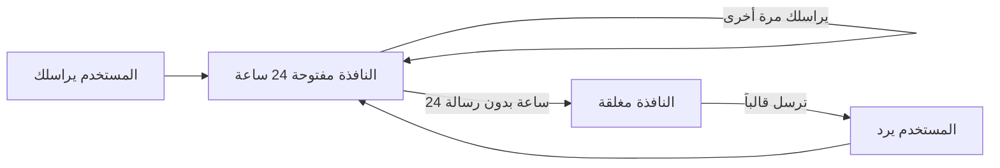

واتساب لا يسمح للأنشطة بمراسلة الناس متى ما أرادت. هل تقدر ترسل رسالة عادية أم تحتاج قالباً معتمداً؟ يعتمد ذلك على شيء واحد: هل **نافذة خدمة العملاء** مفتوحة مع هذا الشخص.

## كيف تعمل

عندما يراسلك المستخدم تُفتح نافذة مدتها 24 ساعة. خلالها تقدر ترسل أي نوع رسالة: نص، وسائط، رسائل تفاعلية، مواقع، تفاعلات. وكل رسالة جديدة من المستخدم تعيد العدّ من جديد.

عندما تُغلق النافذة، لا يقبل واتساب إلا [القوالب](/ar/whatsapp-api/templates/overview) لهذا الشخص، والرسالة الحرة تفشل بالخطأ `131047`. وعندما يرد المستخدم على قالبك تُفتح نافذة جديدة.

## مدة النافذة

| كيف بدأت المحادثة | النافذة |
| --- | --- |
| المستخدم راسلك أو اتصل بك | 24 ساعة، تتجدد مع كل رسالة منه |
| المستخدم جاء من إعلان Click to WhatsApp أو من زر **إرسال رسالة** في فيسبوك أو إنستغرام | 24 ساعة مثل أي رسالة. وقد تمنح ميتا هذه المحادثات تسعيراً خاصاً |
| المستخدم لم يراسلك أبداً | لا توجد نافذة. القوالب فقط |

## ماذا تقدر ترسل

| | النافذة مفتوحة | النافذة مغلقة |
| --- | --- | --- |
| الرسائل الحرة (نص، وسائط، تفاعلية…) | نعم | لا |
| القوالب | نعم | نعم |
| إشعار القراءة ومؤشر الكتابة | نعم | لا |

القوالب تُحتسب حسب فئتها سواء كانت النافذة مفتوحة أو لا. راجع [التسعير والمحفظة](/ar/whatsapp-api/pricing-and-wallet).

## تتبّع النافذة

النافذة تُحسب لكل مستخدم ولكل رقم. لتعرف إن كانت مفتوحة:

1. خزّن `timestamp` لآخر رسالة واردة من المستخدم من [الـ Webhook](/ar/whatsapp-api/webhooks/events#الرسائل-الواردة).
2. قبل إرسال رسالة حرة، تأكد أنه أحدث من 24 ساعة.
3. إذا كان أقدم، أرسل قالباً.

اترك هامش دقائق قليلة حتى لا تُرفض رسالة أُرسلت قبل انتهاء المهلة بلحظات.

## ممارسات جيدة

- رد داخل النافذة. من ينتظر أكثر من يوم احتمال رده أقل.
- إذا أُغلقت النافذة وسط محادثة، أرسل قالباً خدمياً قصيراً يشير للطلب المفتوح، مثل "تذكرتك #1042 فيها تحديث. رد لنكمل".
- لا تستخدم القوالب للالتفاف على النافذة بالتسويق. الناس يحظرون الأنشطة التي تفعل ذلك، فينخفض [تقييم الجودة](/ar/whatsapp-api/account/quality-rating).
