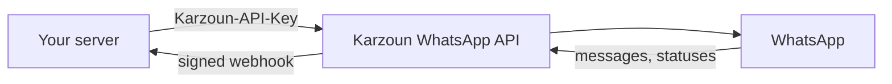

WhatsApp API من كرزون تربط نظامك بواتساب للأعمال. كرزون **شريك حلول واتساب رسمي** من ميتا: نربط رقمك ونسجّله، ونحسب الرسائل من محفظتك في كرزون، ونوصل أحداث رقمك إلى خادمك.

الـ API مبنية على منصة واتساب للأعمال الرسمية (Cloud API). كائنات الرسائل ومكوّنات القوالب وأحداث الـ Webhook كلها بالصيغة القياسية لواتساب، فأي كود كتبته لـ Cloud API يعمل معها كما هو.

## كيف تعمل

- **الطلبات:** أرسل طلباتك إلى `https://waba.karzoun.chat` بمفتاح API واحد لكل رقم. المفتاح يحدد الرقم، فلا تحتاج المسارات أبداً إلى معرّف الرقم أو الحساب.
- **الأحداث:** كرزون توصل كل رسالة وتحديث حالة لرقمك إلى رابط الـ Webhook عندك، موقّعاً، مع إعادة المحاولة وسجل للإرسال.
- **الفوترة:** كل إرسال مدفوع يحجز تكلفته من محفظتك أولاً. إذا لم يكفِ الرصيد يرجع الطلب `402` ولا يُرسل شيء.

## ماذا تستطيع أن تفعل

| المجال | ما يتوفر |
| --- | --- |
| المراسلة | نصوص، وسائط، رسائل تفاعلية، مواقع، جهات اتصال، تفاعلات، قوالب، إشعار القراءة ومؤشر الكتابة، و[Marketing Messages](/ar/whatsapp-api/messaging/send-messages#رسائل-التسويق) |
| [الوسائط](/ar/whatsapp-api/messaging/media) | رفع، قراءة، تنزيل، حذف، ورفع عيّنات القوالب |
| [القوالب](/ar/whatsapp-api/templates/manage) | إنشاء، عرض، تعديل، حذف، ومكتبة القوالب |
| [Flows](/ar/whatsapp-api/messaging/flows) | إنشاء، رفع ملف JSON، نشر، إيقاف |
| [المجموعات](/ar/whatsapp-api/messaging/groups) | إنشاء وإدارة روابط الدعوة والأعضاء وطلبات الانضمام |
| [الاتصال](/ar/whatsapp-api/messaging/calling) | بدء المكالمات، إعدادات الاتصال، صلاحيات الاتصال |
| [إعدادات الرقم](/ar/whatsapp-api/messaging/number-settings) | الملف التجاري، حالة الرقم، الحظر، بيانات الامتثال، التشفير، عناصر المحادثة |
| [Webhooks](/ar/whatsapp-api/webhooks/overview) | رابط Webhook لكل رقم، مفتاح توقيع، حدث تجريبي، سجل إرسال |

## ابدأ من هنا

<CardGroup cols={2}>
  <Card title="البداية السريعة" icon="rocket" href="/ar/whatsapp-api/quickstart">
    اربط رقماً، أنشئ مفتاحاً، وأرسل أول رسالة.
  </Card>
  <Card title="المصادقة" icon="key" href="/ar/whatsapp-api/authentication">
    كيف تعمل مفاتيح API وكيف تحميها.
  </Card>
  <Card title="Webhooks" icon="webhook" href="/ar/whatsapp-api/webhooks/overview">
    استقبل الرسائل وتحديثات الحالة على خادمك.
  </Card>
  <Card title="مرجع الـ API" icon="code" href="/whatsapp-api/reference/send-a-message">
    كل endpoint مع أمثلة الطلب والرد.
  </Card>
</CardGroup>

<Note>
  WhatsApp API جزء من **باقة API**. إذا كنت تبني منتجاً لعملائك، راجع [الشركاء](/ar/partners): حسابات العملاء، وروابط الربط، وWebhook الشريك.
</Note>
