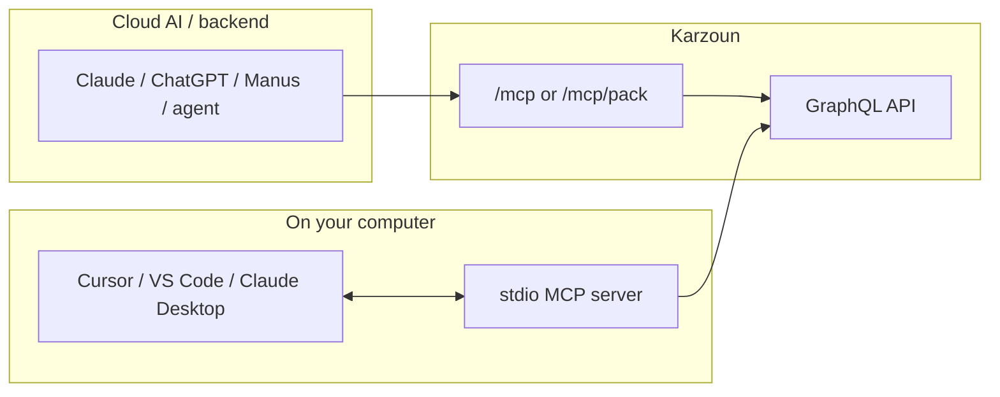

Give AI assistants **structured access** to your Karzoun workspace — customers, inbox, WhatsApp, automations, and more — through the [Model Context Protocol](https://modelcontextprotocol.io/).

The `@karzounchat/mcp-server` package maps the **public GraphQL API** to MCP tools. Prefer a **pack** so the agent only sees the tools for its job.

**Package:** [`@karzounchat/mcp-server`](https://www.npmjs.com/package/@karzounchat/mcp-server)
**Source:** [KarzounApps/mcp-server](https://github.com/KarzounApps/mcp-server)
**In-app:** **Developer → MCP setup** (`/developer/mcp-setup`)

## Choose your setup

|                 | **Local**                                                              | **HTTP**                                                                     |
| --------------- | ---------------------------------------------------------------------- | ---------------------------------------------------------------------------- |
| **Best for**    | Cursor, VS Code, Claude Desktop on your laptop                         | Claude, ChatGPT, Manus, Gemini, Grok, remote agents                          |
| **Runs as**     | `npx @karzounchat/mcp-server` (stdio)                                  | `POST https://{subdomain}.api.karzoun.chat/mcp` or `/mcp/{pack}`             |
| **Token lives** | MCP config `env` on your machine                                       | Trusted AI host or your backend — never the browser                          |
| **Setup guide** | [Cursor](/mcp-server/setup/cursor) · [VS Code](/mcp-server/setup/vscode) · [Claude Desktop](/mcp-server/setup/claude-desktop) | [AI connectors](/mcp-server/setup/ai-connectors) · [HTTP MCP](/mcp-server/setup/hosted) |

## Packs (recommended)

| Pack | Use for |
|------|---------|
| `customer-support` | Inbox, contacts, companies, tags, reply templates |
| `marketing` | Broadcasts, segments, forms, products |
| `operations` | Tasks, team chat, org, users, products |
| `whatsapp` | WhatsApp messaging, templates, flows |
| `automations` | Automation flows and nodes |
| `integrations` | Apps, webhooks, MiniApps |
| `ai` | Knowledge base |
| `full` | Entire public API (large) |

Local: set `KARZOUN_MCP_PACK`. HTTP: use `/mcp/{pack}` or `GET /mcp/packs`.

## Prerequisites

1. **App token** — **Developer → Apps** ([authentication](/developers/getting-started/authentication))
2. **GraphQL URL** — `https://{subdomain}.api.karzoun.chat/graphql`
3. **Permissions** — Scope the app to what the agent needs

<Warning title="Not a replacement for GraphQL">
  MCP is a **convenience layer for AI clients**. Production integrations that do not need an LLM should call GraphQL or [webhooks](/developers/guides/webhooks) directly.
</Warning>

## Start here

| Step | Guide |
| ---- | ----- |
| 1 | [How it works](/mcp-server/guides/how-it-works) |
| 2 | Pick Local ([Cursor](/mcp-server/setup/cursor) / [VS Code](/mcp-server/setup/vscode)) or HTTP ([connectors](/mcp-server/setup/ai-connectors)) |
| 3 | [Agent patterns](/mcp-server/guides/agent-patterns) |
| 4 | [Tool catalog](/mcp-server/tools/catalog) |

## Configuration reference (local)

| Variable                         | Required | Description |
| --------------------------------- | -------- | ----------- |
| `KARZOUN_API_URL`                | Yes      | GraphQL endpoint URL |
| `KARZOUN_APP_TOKEN`              | Yes      | App JWT |
| `KARZOUN_MCP_PACK`               | No       | Pack id (default `full`) |
| `KARZOUN_MCP_FETCH_TIMEOUT_MS`   | No       | GraphQL fetch timeout ms (default: 30000) |
| `KARZOUN_MCP_MAX_RESPONSE_BYTES` | No       | Response cap (default: 524288) |

Hosted gateway: `MCP_RATE_LIMIT_PER_MIN` (default `120` POSTs/min per app token; `0` disables).

## Related

- [Security](/mcp-server/setup/security)
- [Troubleshooting](/mcp-server/guides/troubleshooting)
- [GraphQL API](/developers)
