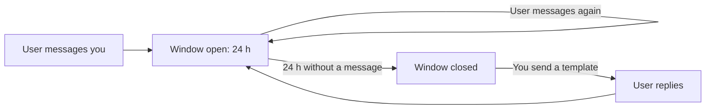

WhatsApp doesn't let businesses message people whenever they like. Whether you can send a normal message or need an approved template depends on one thing: whether a **customer service window** is open with that person.

## How it works

When a user messages you, a 24-hour window opens. While it's open you can send any message type: text, media, interactive messages, locations, reactions. Each new message from the user restarts the 24 hours.

When the window closes, WhatsApp accepts only [templates](/whatsapp-api/templates/overview) to that person. A free-form message fails with error `131047`. When the user replies to your template, a new window opens.

## Window length

| How the conversation started | Window |
| --- | --- |
| The user messaged or called you | 24 hours, restarted by each new message from them |
| The user came from a Click to WhatsApp ad or a Facebook or Instagram **Send message** button | 24 hours, like any user message. Meta may give these conversations special pricing |
| The user has never messaged you | No window. Only templates |

## What you can send

| | Window open | Window closed |
| --- | --- | --- |
| Free-form messages (text, media, interactive…) | Yes | No |
| Templates | Yes | Yes |
| Read receipts and typing indicator | Yes | No |

Templates are billed by their category whether or not a window is open. See [Pricing and wallet](/whatsapp-api/pricing-and-wallet).

## Track the window

The window is calculated per user and per number. To know whether it's open:

1. Store the `timestamp` of the user's last incoming message from your [webhook](/whatsapp-api/webhooks/events#incoming-messages).
2. Before sending free-form, check that it's less than 24 hours old.
3. If it's older, send a template instead.

Leave a margin of a few minutes, so a message sent just before the deadline isn't rejected.

## Good practice

- Answer inside the window. Users who wait more than a day are less likely to reply.
- If the window closed mid-conversation, send a short utility template that refers to the open request, such as "Your ticket #1042 has an update. Reply to continue."
- Don't use templates to bypass the window with marketing. People block businesses that do, and your [quality rating](/whatsapp-api/account/quality-rating) drops.
