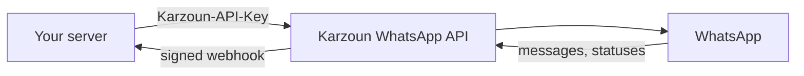

The Karzoun WhatsApp API connects your software to WhatsApp Business. Karzoun is an official Meta **WhatsApp Solution Partner**: we connect and register your number, bill messaging to your Karzoun wallet, and deliver your number's events to your server.

The API is built on the official WhatsApp Business Platform (Cloud API). Message objects, template components and webhook events use WhatsApp's standard format, so code written for the Cloud API works with it as is.

## How it works

- **Requests:** call `https://waba.karzoun.chat` with one API key per phone number. The key identifies the number, so endpoints never need a phone number ID or account ID.
- **Events:** Karzoun delivers every message and status update for your number to your webhook URL, signed, with retries and a delivery log.
- **Billing:** each billable send reserves its cost from your wallet first. If the wallet can't cover it, the request returns `402` and nothing is sent.

## What you can do

| Area | Endpoints |
| --- | --- |
| Messaging | Text, media, interactive, location, contacts, reactions, templates, read receipts, typing indicators, [Marketing Messages](/whatsapp-api/messaging/send-messages#marketing-messages) |
| [Media](/whatsapp-api/messaging/media) | Upload, retrieve, download, delete; resumable upload for template samples |
| [Templates](/whatsapp-api/templates/manage) | Create, list, read, edit, delete, template library |
| [Flows](/whatsapp-api/messaging/flows) | Create, upload JSON, publish, deprecate |
| [Groups](/whatsapp-api/messaging/groups) | Create, manage invite links, participants and join requests |
| [Calling](/whatsapp-api/messaging/calling) | Start calls, calling settings, call permissions |
| [Number settings](/whatsapp-api/messaging/number-settings) | Business profile, health status, block users, compliance, encryption, conversational components |
| [Webhooks](/whatsapp-api/webhooks/overview) | Per-number webhook URL, signing secret, test event, delivery log |

## Start here

<CardGroup cols={2}>
  <Card title="Quickstart" icon="rocket" href="/whatsapp-api/quickstart">
    Connect a number, create a key and send your first message.
  </Card>
  <Card title="Authentication" icon="key" href="/whatsapp-api/authentication">
    How API keys work and how to keep them safe.
  </Card>
  <Card title="Webhooks" icon="webhook" href="/whatsapp-api/webhooks/overview">
    Receive messages and status updates on your server.
  </Card>
  <Card title="API reference" icon="code" href="/whatsapp-api/reference/send-a-message">
    Every endpoint with request and response examples.
  </Card>
</CardGroup>

<Note>
  The WhatsApp API is part of the **API plan**.
</Note>
